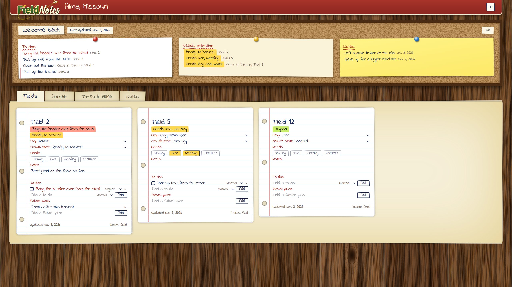

# Field Notes

A status board and reminder notebook for Farming Simulator 25. Update it at the end of a session,
and when you come back weeks or months later it reminds you where you left off.

It runs in Docker on the home server, is LAN only with no login, and is laid out for a 1440p desktop
monitor.



## What's on the page
The page looks like a farm desk: wooden planks, a barn-red sign for the header, and handwriting on
notebook paper.

- **Header:** the map name (hover over it to edit) and a **+** button for adding anything. Pick an
  item and it opens that tab, then adds a blank card or puts the cursor in that list's Add box.
- **Welcome back corkboard:** the date of the last update, then three pinned sheets: open to-dos
  (urgent first), everything that needs attention, and notes. It's read-only, so click an item to jump
  to where it's edited. Hide collapses it, and it reopens every time the page loads.
- **Fields tab:** a card per field with its crop, growth state, needs (plowing, lime, weeding,
  fertilizer, soil sampling), notes, to-dos and future plans.
- **Animals tab:** a card per group of animals with its type, location, food status, notes, to-dos and
  future plans. When food is "Not good", a "What they need" box appears.
- **To-Do & Plans tab:** general to-dos and future plans that don't belong to a card.
- **Notes tab:** short reminders to yourself on post-its, such as "left a grain trailer at the silo",
  each with an optional longer explanation.

Field and animal cards have colour-coded highlighter badges: red for urgent, amber for needs attention,
green for all good. Everything saves by itself shortly after you stop typing.

**Good to know:** keep the page open in only one browser tab. Each save replaces the whole farm, so an
out-of-date second tab would overwrite newer edits.

## Install on Unraid
```sh
cd /mnt/user/appdata
git clone https://github.com/BrandonSmith8038/farm-sim-status.git farm-sim-status-src
cd farm-sim-status-src
cp .env.example .env
docker compose up -d --build
```
Then open `http://<Server IP>:8210`.

To use a different port, change `PORT` in `.env` and rebuild.

The app is called Field Notes on the page, but the container and folders are named `farm-sim-status`.

The Unraid Docker tab icon comes from the `net.unraid.docker.icon` label in `docker-compose.yml`, which
contains the server's IP address. If the IP changes, update the label and rebuild.

## Update
```sh
cd /mnt/user/appdata/farm-sim-status-src
git pull
docker compose up -d --build
```
Your data lives outside the container, so rebuilding doesn't touch it.

## Your data
Everything is in one file: `/mnt/user/appdata/farm-sim-status/farm.json`.

- **Back up:** copy that file somewhere safe. This is fine while the container is running.
- **Restore:** stop the container first, put the file back, then start it again. The server only reads
  the file at startup, so while it's running it would ignore your copy and overwrite it on the next
  save.
  ```sh
  cd /mnt/user/appdata/farm-sim-status-src
  docker compose stop
  cp /path/to/your/backup/farm.json /mnt/user/appdata/farm-sim-status/farm.json
  docker compose start
  ```
- **`farm.json.corrupt-<timestamp>`:** if the server can't read `farm.json` at startup, it renames the
  file to this and starts with an empty farm. Your old data is still in that file, ready to be repaired
  or replaced from a backup.

## Change the dropdowns
Edit these lists, then rebuild:
- `CROPS` and `GROWTH_STATES` in [public/fields.js](public/fields.js)
- `ANIMAL_TYPES` in [public/animals.js](public/animals.js)

Badges depend on the growth states named `Withered` and `Ready to harvest`, so keep those names.

## Run the tests
The tests need Node 20 or newer and use a temporary folder, so they never touch your real farm. The
source folder has no `node_modules`, so copy the project to a local folder first, then run this there:
```sh
npm ci
npm test
```

## Credits
The handwriting fonts are [Indie Flower](https://fonts.google.com/specimen/Indie+Flower) and
[Patrick Hand](https://fonts.google.com/specimen/Patrick+Hand), both under the SIL Open Font License.
They and their licenses are in [public/fonts/](public/fonts/).

## What's next
Later ideas: more sections, animal-specific food needs, ntfy reminders, a Stream Deck button.
